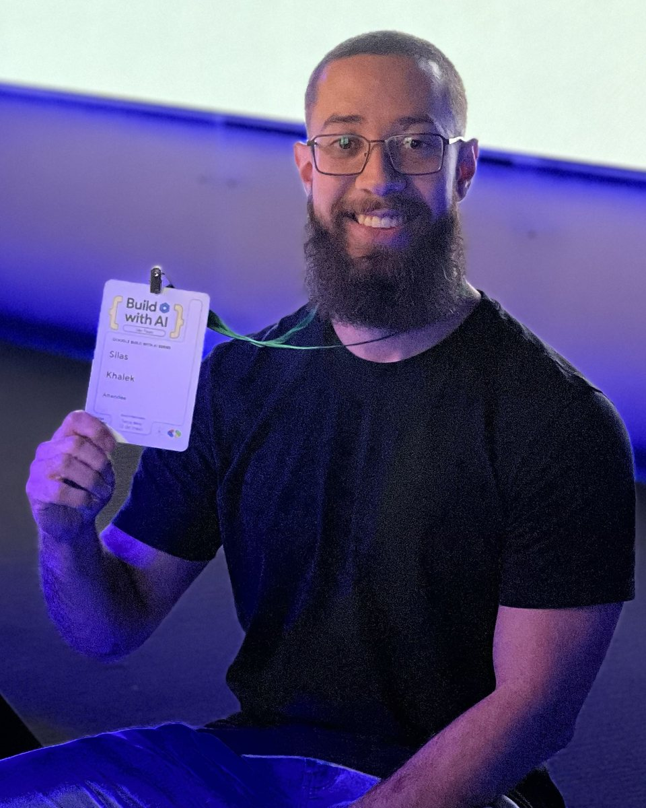

# Silas Khalek · Your AI Creator

Site pessoal e página de lista de espera do curso de criação com IA.

Site estático (HTML + CSS + JS puro), sem build. Para ver localmente:

```bash
python3 -m http.server 8000
# abra http://localhost:8000
```

## Configuração

Edite o objeto `CONFIG` no topo de `script.js`:

- `instagram`: seu @ sem o "@". Vazio esconde os links do Instagram.
- `formEndpoint`: URL que recebe os cadastros da lista de espera (ex.: um formulário do [Formspree](https://formspree.io)). Recebe `nome`, `email` e `whatsapp` em JSON.
- `whatsapp`: alternativa sem backend; número com DDI e DDD (ex.: `5511999999999`). O cadastro abre uma conversa no WhatsApp com os dados preenchidos.

Sem `formEndpoint` nem `whatsapp`, o formulário mostra erro ao enviar.

## Foto

Coloque sua foto em `assets/silas.jpg` e troque o bloco `.about__placeholder` em `index.html` por:

```html

```

## Publicar

Funciona direto na Vercel, Netlify ou GitHub Pages: é só apontar para a raiz do repositório, sem comando de build.
